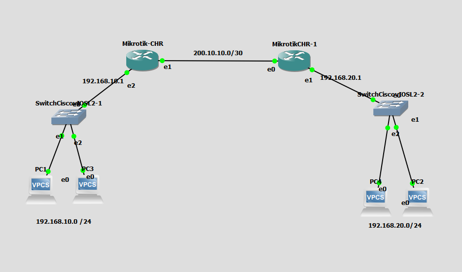

# GNS3 Lab — MikroTik Static Routing

[Bahasa Indonesia](README.md)

Static-routing practice lab with two MikroTik routers, two LANs, and four VPCS nodes. Screenshot shows topology only.

## Topology

The routers connect over WAN subnet `200.10.10.0/30`. Left LAN `192.168.10.0/24` uses gateway `192.168.10.1`; right LAN `192.168.20.0/24` uses gateway `192.168.20.1`.

## Configuration files

- `configs/routers/MikroTik-CHR.rsc` — example configuration for the left router.
- `configs/routers/MikroTikCHR-1.rsc` — example configuration for the right router.
- `configs/pcs/PC1.vpc` through `PC4.vpc` — original VPCS startup files available in the project.

Router configs are **examples created for this lab**, not exports from running routers. The diagram gives the WAN subnet but not host IPs; examples assume `200.10.10.1/30` on the left router and `200.10.10.2/30` on the right. Verify interface names against your local CHR template before importing or running.

Available PC startup addresses: PC1 `192.168.10.3/24`, PC3 `192.168.10.2/24`, PC2 `192.168.20.2/24`, PC4 `192.168.20.3/24`; gateways point to `.1` in each LAN.

## Connectivity test

After applying configs, ping between routers over WAN, then ping between PCs across subnets. Verify WAN/LAN interfaces and static routes with `/ip route print`.

## Requirements

GNS3 and legally obtained MikroTik CHR and Cisco vIOS-L2 images. Vendor images/runtime disks are not included. Map local image/template names as needed.
