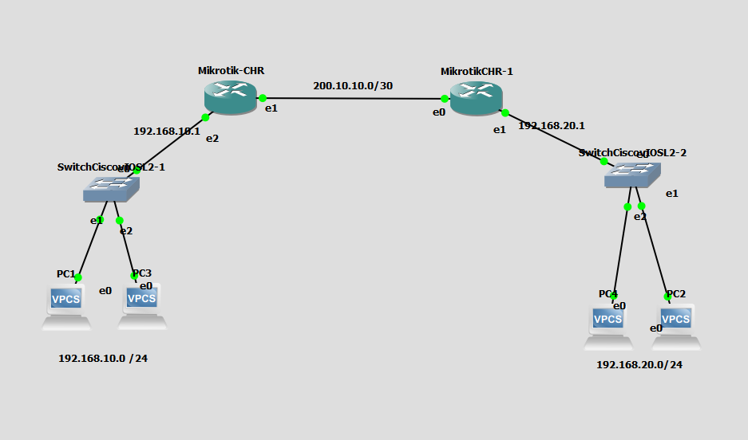

# Lab GNS3 — Static Routing MikroTik

[English](README.en.md)

Lab latihan static routing dua router MikroTik, dua LAN, dan empat VPCS. Screenshot hanya menampilkan topology.

## Topology

Dua router tersambung melalui WAN `200.10.10.0/30`. LAN kiri `192.168.10.0/24` memakai gateway `192.168.10.1`; LAN kanan `192.168.20.0/24` memakai gateway `192.168.20.1`.

## File konfigurasi

- `configs/routers/MikroTik-CHR.rsc` — contoh konfigurasi router kiri.
- `configs/routers/MikroTikCHR-1.rsc` — contoh konfigurasi router kanan.
- `configs/pcs/PC1.vpc` sampai `PC4.vpc` — startup config asli VPCS yang ada di project.

Konfigurasi router **dibuat sebagai contoh**, bukan diekspor dari router berjalan. Diagram hanya memberi subnet WAN, bukan IP host WAN; contoh mengasumsikan `200.10.10.1/30` di router kiri dan `200.10.10.2/30` di router kanan. Verifikasi nama interface pada template CHR lokal sebelum import/jalankan.

Startup PC yang tersedia: PC1 `192.168.10.3/24`, PC3 `192.168.10.2/24`, PC2 `192.168.20.2/24`, PC4 `192.168.20.3/24`; gateway mengarah ke `.1` masing-masing LAN.

## Uji konektivitas

Setelah konfigurasi diterapkan, ping antar-router melalui WAN, lalu ping antar-PC lintas subnet. Pastikan interface WAN/LAN benar dan route static muncul di `/ip route print`.

## Kebutuhan

GNS3 dan image MikroTik CHR serta Cisco vIOS-L2 yang diperoleh secara sah. Image vendor/runtime tidak disertakan. Sesuaikan mapping image/template pada mesin lokal.
